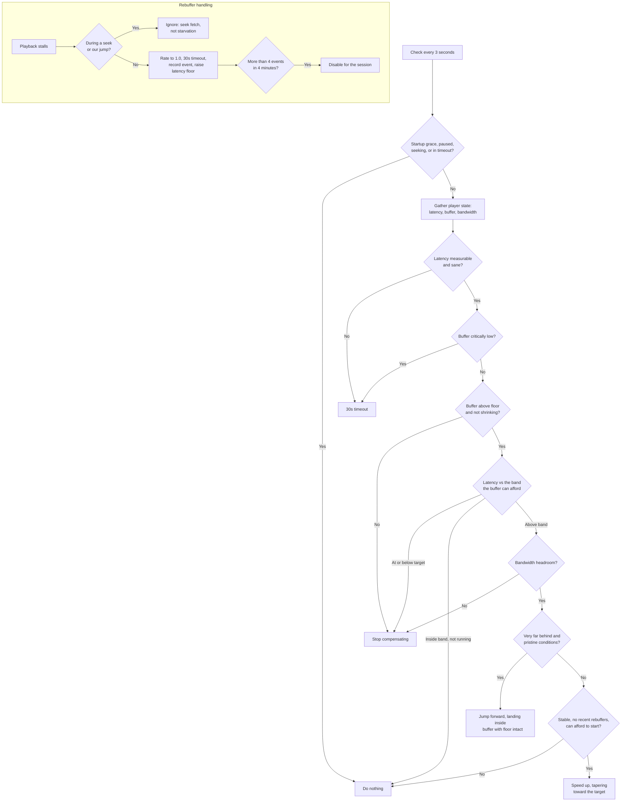

# Owncast Live Video Latency Compensator

## Overview

The Owncast Latency Compensator is a JavaScript module designed to keep HLS video streams using [VideoJS](https://videojs.com/) [VHS](https://github.com/videojs/http-streaming) to have as low latency as possible given the network conditions for the player. It is not compatible with device-native HLS playback such as Safari. It aims to stay as close to the live edge as possible without causing buffering or playback issues. It works by intelligently adjusting playback speed and, when necessary, jumping forward in the stream to reduce latency between the viewer and the live broadcast.

## How It Works

### The Latency Problem

In live streaming, viewers are always slightly behind the actual live broadcast. This delay (latency) occurs due to:

1. **Server-side delays**: The time it takes to encode and package video segments. This is generally a static amount of time and won't increase or decrease during a stream.
2. **Client-side delays**: Natural stutters in playback, processing delays, and network hiccups that compound over time. This can increase and decrease over time during playback for a number of reasons. They are generally not visible.
3. **Buffering**: Any time you buffer, playback stops and you will be behind live an additional amount the time you buffered. This is the largest reason for large amounts of latency. If your stream is configured in a way that causes a viewer to buffer, you've already lost the latency game and need to go back to reconfiguring your stream.

Without intervention, this latency can grow from a few seconds to many seconds or even minutes, making the viewing experience feel less "live."

### The Solution

The Latency Compensator monitors your stream's latency and takes action when you fall too far behind:

1. **Speed Adjustment**: Gradually increases playback speed to catch up, tapering back to normal speed as it approaches the target so it never overshoots
2. **Forward Jumping**: In extreme cases, skips ahead. Jumps are only ever forward, only land inside already-buffered content, and always leave a safety buffer behind
3. **Buffer First**: Near the live edge, latency can only be reduced by spending buffer. The compensator never spends below a floor derived from the segment duration, and every latency target is subordinate to that floor. When the floor is reached, compensation stops, wherever that leaves you
4. **Backs Off**: Any rebuffering pauses all compensation and raises the latency target. Too many rebuffering events disable it for the session

### Video playback requirements

- The speed a viewer is consuming video into the player must be fast enough to allow faster than realtime playback. The latency compensator keeps an eye on the download speed and the amount of already buffered video when making decisions on if, and how much, latency can be compensated for.
- The smaller the segment duration is, the lower you can get your latency.

### Where will this not work?

You _need_ be using the VideoJS VHS tech for this to work. That means anything using native playback (such as HLS on Safari) are not supported. You will want to check what method of playback tech is being used before you use this.

The bandwidth safety gate also needs to know the stream's bitrate, which comes from the `BANDWIDTH` attribute in the master playlist. Streams served as a bare media playlist with no master never pass the gate, so the compensator stays safely inert on them. Owncast always serves a master playlist.

## Key Features

### Imperceptible Speed Changes

- Uses micro-adjustments that are below the threshold of human perception
- Speed changes are spread over minutes rather than seconds
- Audio pitch and tempo changes are virtually unnoticeable

### Buffer Protection

- Never spends buffer below a floor of `max(1.5 × segment duration, 4s)`
- Latency targets adapt to what the buffer can afford: the compensator will not chase a wall-clock number the buffer cannot reach
- Smooths the buffer signal over several samples so the natural per-segment sawtooth never triggers false alarms
- Immediately stops all compensation if genuine rebuffering occurs. Stalls caused by the viewer seeking are recognized and not held against the stream

### Earned Trust

After 3 continuous minutes with zero rebuffering and solid bandwidth headroom, the safety cushion thins: the buffer floor relaxes to `max(segment duration + 1s, 3s)` and the minimum latency target from 4s to 3s. Catch-ups performed while trusted descend roughly a second closer to live (more on short segments, where the untrusted 4s floor dominates). Trust is revoked instantly by any rebuffer, timeout, or loss of bandwidth headroom, and must be re-earned in full. The trade is explicit: a by-construction margin becomes an evidence-based one, so the `trusted` flag is exposed in stats for anyone rolling this out who wants to count stalls-while-trusted in the wild.

### Wrong Clocks Handled

Latency math needs the viewer's clock and the server's clock to agree. Owncast measures and sets the skew via `setClockSkew`. When that is never called (other VideoJS embedders), the compensator self-estimates from segment publish times and corrects clock errors larger than 10 seconds. Clocks that are minutes off used to make it permanently inert. Well-synced clocks are never perturbed.

### Caution That Survives Reloads

Rebuffering history is kept in `sessionStorage`, so a viewer who buffered and refreshed the page gets a compensator that already knows to be careful, not a fresh aggressive one. Events still expire after 4 minutes. Environments without storage degrade silently to in-memory behavior.

### Conservative Decision Making

- Waits for the stream to stabilize after startup
- Requires multiple consecutive stable checks before making changes
- Uses conservative bandwidth estimates based on historical data
- Remembers buffering events and becomes progressively more cautious

### Intelligent Thresholds

The compensator operates within dynamically calculated zones based on segment duration:

- **Comfort Zone**: Close enough to live that no action is needed
- **Action Zone**: Far enough behind that catching up would be beneficial
- **Safety Zone**: Maintains a minimum distance from live to prevent buffering

During active compensation the player's renditions are restricted so freed headroom goes toward catching up. The default mode pins to the lowest-bandwidth rendition; `qualityPinMode: "current"` instead only blocks quality upswitches, which is gentler for viewers. All renditions are restored the moment compensation stops, in every mode.

## Configuration

The compensator uses various tunable constants that control its behavior:

- **Buffering Limits**: How many buffering events before giving up
- **Speed Limits**: Maximum playback speed increase
- **Ramp Rates**: How quickly speed changes are applied
- **Check Intervals**: How often the system evaluates conditions
- **Bandwidth Requirements**: Minimum network headroom needed
- **Buffer Requirements**: Minimum buffer health for safe operation
- **Startup Delays**: Time to wait before beginning compensation

See the constants at the top of the script for current values and tuning.

## Usage

### Basic Setup

```javascript
import LatencyCompensator from "./latencyCompensator.js";

// Initialize with your video.js player instance. Options are optional:
// qualityPinMode: "lowest" (default) pins to the cheapest rendition while
// actively compensating; "current" only blocks quality upswitches.
const compensator = new LatencyCompensator(player, { qualityPinMode: "lowest" });

// Set clock skew with the time skew in milliseconds from the server.
// Optional: without it, clock errors larger than 10s are self-estimated
// from segment publish times.
compensator.setClockSkew(skewInMilliseconds);

// Enable the compensator
compensator.enable();
```

### Watching what it decides

Every check (about every 3 seconds) the compensator reports its state and its
latest decision through an optional callback:

```javascript
compensator.onStats = (stats) => {
  // stats.action is the decision just made: { type, reason } plus
  // rate (speed) or aheadSec (jump). type is one of:
  // "speed", "jump", "stop", "timeout", "none", or "idle" when the
  // compensator cannot run at all (startup grace, paused, no VHS tech).
  // It is null until the first check has run.
  if (stats.action) {
    console.log(stats.action.type, stats.action.reason);
  }

  // Also included: latency, playbackRate, targetRate, running,
  // playableBufferSeconds, bufferFloorSeconds, averageBandwidthRatio,
  // minEndingLatency / maxStartingLatency (the current latency band),
  // consecutiveStableChecks, bufferingEvents, inTimeout, timeoutRemaining,
  // and trusted (whether the earned-trust cushion is active).
};
```

The `reason` string explains every choice, including inaction, so a stats
consumer can always answer "why is nothing happening right now".

## Demo Page

Change to the `demo` directory and install the dependencies and run the demo server. You can then visit `http://localhost:8080` to test the compensator in action with a basic test page. The Player Stats tab shows the compensator's current decision and why, the signals feeding it (latency vs. its target band, buffer vs. floor, bandwidth headroom, stability), and a decision log that records each change of behavior. The preloaded source list includes verified public Owncast streams labeled by segment duration, from 1s (the tightest regime) to 8s, alongside the local test stream below.

- `npm install`
- `npm start`

`npm start` re-syncs the demo's copy of `latencyCompensator.js` from the repo root, so edits to the root file are always what the page runs.

### Local test stream (no server required)

You do not need Owncast or any remote stream to test. With `ffmpeg` installed, run in a second terminal:

- `npm run stream`

This generates a real sliding-window live HLS stream (test pattern with burned-in wall-clock time, program-date-time tags, master playlist) into `demo/local-hls/`. Pick "Local Test Stream" from the demo page's source list. `SEGMENT_DURATION` (default 2, Owncast's default is 4) and `HLS_LIST_SIZE` (default 6) environment variables control the stream shape. Use your browser dev tools' network throttling to simulate bad connections.

## Testing

The behavioral contract lives in `test/` and runs with `node --test` from the repo root (Node 20+, no dependencies):

- `test/decide.test.js`: table-driven contract tests against the pure `decide()` function, of the form "10s behind live with conditions X must produce action Y", plus a property sweep proving jumps are always forward, always land inside buffered content, and rates stay within bounds
- `test/scenarios.test.js`: deterministic multi-minute simulations (fake player, fake clock) covering steady networks, degrading bandwidth, jitter, clock skew, pauses, cold starts far behind live, and rebuffer-limit shutdown. Every scenario asserts the safety invariants, including that a viewer with the compensator never stalls more than one without it
- `test/old-implementation-teeth.test.js`: runs the pre-rewrite implementation through the same harness and proves the suite catches its bugs

## Safety model

The core rule: the compensator must never make the experience worse than not having it at all. Every action is gated on bandwidth headroom, buffer above the floor, and a stable player. When any of those degrade it backs off first and asks questions later. When measurements look absurd (clock problems, long suspends) it does nothing rather than act on bad data. The test suite enforces a zero-added-stalls invariant across every simulated scenario.

## Contributions

Since, in theory, this small library is helpful to anybody using VideoJS's HTTP Streaming, if we all band together we should be able to work out bugs and improving this so all of us have something that helps us with our respective projects.

## Diagram

Follow the chart to see how the different decisions are made.


